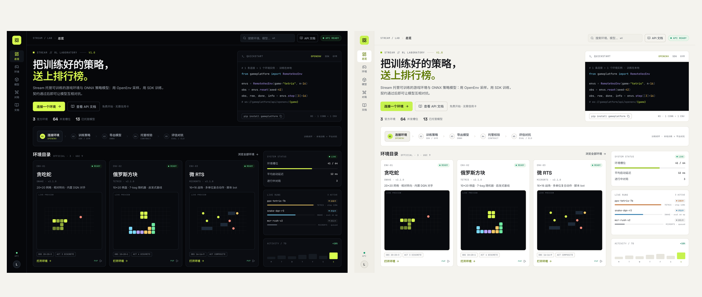

# Stream 前端重设计 · RL 实验室控制台

> 交付物：Pen 设计文件 [stream-lab-redesign.pen](./stream-lab-redesign.pen) + 2x PNG（[exports/](./exports/)），含**亮色（默认）/ 深色（可选）两套主题**。
> 设计依据：`README.md` + `docs/pm/01-定位与用户.md` + `docs/pm/02-功能与模块清单.md` 的功能与定位信息；
> **未参考 `web/` 现有前端**（含其页面、组件与 DESIGN.md），信息架构与视觉方向均为从零设计。
> 画面中的数据均为演示数据，用于表达信息密度与层级。

## 1. 设计概念

**「实验室控制台 / Laboratory Console」**：把 Stream 当作一台随时可读数的 RL 仪器，而不是游戏大厅。

- **暗色基底**：近黑背景 + 1px 发丝线 + 极低对比面板，让数据与信号色成为唯一焦点
- **信号绿（#D8FF4F）**：唯一主强调色，只用于主 CTA、当前状态、成功信号与关键数值
- **数据色**：cyan / violet / amber / green / red 仅用于区分游戏、模型、资源与结果
- **技术排版**：Space Grotesk（标题/大数字）、Inter（正文）、JetBrains Mono（ID、契约、遥测、代码）
- **结构**：左侧 84px 图标导航 + 60px 顶部指挥栏 + 主内容区 + 右侧遥测/详情列；卡片 10px 圆角、细边框，不使用重投影
- **叙事主次**：主旅程固定为 **环境 → 训练 → ONNX → 托管 → 对抗**；玩 / PvP 作为「环境页」里的验证入口，不设独立对战中心（遵循 D27，不恢复 `/arena`）

## 2. 信息架构

| 一级导航 | 路径 | 说明 |
|---|---|---|
| 总览 | `/` | 训练闭环叙事、Quickstart、环境目录、系统遥测 |
| 环境 | `/environments`、`/environments/:slug` | 环境目录 + 契约/渲染/试玩/排行 |
| 模型 | `/models` | ONNX 托管、契约校验、评估、模型挑战 |
| 对局 | `/matches`、`/watch/match/:id` | 对局记录、逐帧回放、分享 |
| 文档 | `/api.html` | OpenEnv / SDK 文档（顶栏常驻入口） |

全局：`⌘K` 命令搜索（环境 / 模型 / 对局 / 文档）；右上角常驻 `API READY` 系统状态。

## 3. 页面清单

| # | 文件 | 内容 |
|---|---|---|
| 00 | [exports/00-foundations.png](./exports/00-foundations.png) | 设计系统：色板、字阶、按钮/状态胶囊/契约标签/键帽、间距与圆角 |
| 01 | [exports/01-overview.png](./exports/01-overview.png) | 总览：Hero + 训练闭环 5 步条 + 环境目录卡片（契约优先）+ 系统状态 / Live Runs / 周活动遥测 |
| 02 | [exports/02-environment.png](./exports/02-environment.png) | 环境详情（Tetris）：实时棋盘预览 + HUD、契约规格与校验明细、渲染声明、OpenEnv endpoint、对手、排行榜、Session log |
| 03 | [exports/03-models.png](./exports/03-models.png) | 模型工作台：统计条、筛选、模型表（契约/胜率/对局）、右侧详情（契约校验、评估、近期对局、版本、推理延迟） |
| 04 | [exports/04-matches.png](./exports/04-matches.png) | 对局与回放：对局列表、回放播放器（棋盘 + 动作流 + 时间轴）、比分/分享/对局信息 |
| 05 | [exports/05-mobile-overview.png](./exports/05-mobile-overview.png) | 移动端总览：单列布局 + 底部 Tab Bar + 紧凑环境卡 |

**亮色主题（默认）对应文件**：`00L-foundations.png`、`01L-overview.png`、`02L-environment.png`、`03L-models.png`、`04L-matches.png`、`05L-mobile-overview.png`（同一套信息架构与组件；亮色为默认主题，见 §5.1）。



### 迁移补稿（06–14，2026-10-21）

> 旧页面迁移前补齐的设计稿（深色；亮色为默认版本）。Pen 画布位置：`y=4700` 与 `y=5900` 两排。

| # | 文件 | 内容 |
|---|---|---|
| 06 | [06-play.png](./exports/06-play.png) | 单机试玩：真实棋盘 + 动作控制 + 侧栏战绩/排行榜 |
| 07 | [07-pvp-find.png](./exports/07-pvp-find.png) | PvP 找对手：公开房间表 + 快速匹配 + 邀请码 |
| 08 | [08-pvp-match.png](./exports/08-pvp-match.png) | PvP 对局：棋盘 + 回合动作提交 + 房间聊天 |
| 09 | [09-watch.png](./exports/09-watch.png) | 观战：公开对局只读棋盘 + 房间信息 |
| 10 | [10-replay.png](./exports/10-replay.png) | 回放：逐 tick 重建 + 时间轴 + 调速/分享 |
| 11 | [11-profile.png](./exports/11-profile.png) | 个人资料：资料编辑 + 等级/XP + 战绩墙 |
| 12 | [12-social.png](./exports/12-social.png) | 好友与通知：互加/删除 + 未读与全部已读 |
| 13 | [13-creator.png](./exports/13-creator.png) | 创作者工作台：上传游戏包 + 审核状态列表 |
| 14 | [14-admin.png](./exports/14-admin.png) | 管理后台：数据看板 + 举报/UGC 审核 |

每屏都有**亮色（默认）/ 深色**两个版本（亮色文件以 `L` 结尾，例如 `06-play.png` / `06L-play.png`）：

- 深色汇总（可选）：[06-14-contact.png](./exports/06-14-contact.png)
- 亮色汇总（默认）：[06-14L-contact.png](./exports/06-14L-contact.png)

Pen 画布位置：深色稿 `y=4700` / `y=5900`，亮色稿 `y=7100` / `y=8300`；亮色复用 §5.1 的 token 映射，棋盘/代码等「仪表井」保持深色。

## 4. 设计 Token

### 颜色

| Token | 值 | 用途 |
|---|---|---|
| bg | `#06070A` | 页面背景 |
| surface / surface-2 / surface-3 | `#0B0D12` / `#10141A` / `#161B22` | 卡片 / 悬浮 / 内嵌 |
| line / line-2 | `#1D232C` / `#2B333F` | 发丝线 / 强边框 |
| text / text-2 / text-3 | `#F2F4F7` / `#A4ACB8` / `#6D7683` | 主 / 次 / 弱文本 |
| lime / lime-ink | `#D8FF4F` / `#0B0E06` | 主强调 / 强调上的文字 |
| cyan / violet / green / amber / red | `#7CD9FF` / `#B7A2FF` / `#6EE7A0` / `#F5C867` / `#FF8A7A` | 数据色与语义色 |
| code | `#080A0E` | 代码/棋盘等深色井 |

### 字体与尺寸

- 字族：`Space Grotesk`（display 600）、`Inter`（body 400/500/600）、`JetBrains Mono`（mono 400/500/600）
- 字阶：display 44 / h1 33 / h2 21 / h3 19 / body 14.5 / small 12.5 / micro 10.5 / mono label 8–10（letter-spacing 0.4–1.1）
- 圆角：卡片 10 / 按钮与输入 7 / 标签 4 / 胶囊 999
- 间距：4 · 8 · 12 · 16 · 20 · 24 · 32 · 64；页面内边距 26、卡片内边距 16–20
- 布局：1440×1024 桌面基准，左侧导航 84、顶栏 60；断点建议 1280 / 1024 / 768 / 390

### 组件

主/次/幽灵按钮、图标按钮、状态胶囊（READY / PASS / DRAFT / WIN / LOSS）、契约标签（OBS / ACT）、键帽、进度条、迷你棋盘、指标行、表格行 + 选中态（左侧 2px 信号绿）、遥测卡、时间轴。

### 状态约定（实现时补齐）

- 加载：卡片骨架 + mono 扫描文字；空：单行说明 + 主 CTA；错误：red 边框 + 重试
- 契约失败：amber `DRAFT` + 右侧详情逐项标红；API 离线：顶栏状态胶囊转 red
- 交互：hover 亮一档 surface、focus ring 信号绿 2px、过渡 160–200ms ease-out
- 数据刷新：/api/ready 与遥测轮询 5s；Live Runs 进度条仅做视觉示意

## 5. 与现有实现的映射建议

- 保留现有后端 API 契约；本设计只改信息架构与表现层
- 建议以 `web/src` 重建：`AppShell`（导航 + 顶栏 + 命令面板）、`EnvCard`、`ContractPanel`、`ModelTable`、`ReplayPlayer`、`TelemetryCard` 等组件
- Token 落地为 CSS Variables：**亮色为默认主题**（`gp_lab_theme` 持久化，`?theme=dark` 可预览）；深色可一键切换
- 图标使用 lucide-react；字体通过 Google Fonts 或本地 woff2 自托管（生产建议自托管）

## 5.1 主题：默认亮色（Light）/ 可选深色（Dark）

方向：**纸面亮色 + 墨色文本 + 信号绿**。代码卡、棋盘、回放等「仪表井」保留深色（dark instrument wells），成为亮色界面里的技术焦点，而不是把所有面变白。

| Token | 深色（可选） | 亮色（默认） |
|---|---|---|
| bg | `#06070A` | `#F4F3EE` |
| surface / surface-2 / surface-3 | `#0B0D12` / `#10141A` / `#161B22` | `#FFFFFF` / `#F0EFE9` / `#E7E5DD` |
| rail | `#06070A` | `#EFEDE6`（激活项白底） |
| line / line-2 | `#1D232C` / `#2B333F` | `#E3E0D7` / `#CDC9BF` |
| text / text-2 / text-3 | `#F2F4F7` / `#A4ACB8` / `#6D7683` | `#17181C` / `#4A5058` / `#666B73` |
| lime（填充 / 文字） | `#D8FF4F` | `#C6F24E` / `#5F7A00` |
| lime-ink | `#0B0E06` | `#12140A` |
| cyan / violet / green / amber / red | `#7CD9FF` / `#B7A2FF` / `#6EE7A0` / `#F5C867` / `#FF8A7A` | `#0369A1` / `#6D28D9` / `#059669` / `#B45309` / `#DC2626` |
| 状态底色 | `#0E1A12` / `#1A1508` / `#1A0F0F` | `#E7F5EA` / `#FAF0D7` / `#FBEAEA` |
| code / 仪表井 | `#080A0E` | `#080A0E`（保持不变） |

实现要点：

- 语义变量双主题：`html[data-lab-theme="light"]`（默认）/ `html[data-lab-theme="dark"]`，组件与布局不改
- 主强调拆两档：**填充**用 `#C6F24E`（按钮、进度、选中条），**文字/细线**用 `#5F7A00`，保证白底可读；小尺寸信号点用 `#8FBF00`
- 仪表井内的文字与数据色不随主题反转（始终深底浅字），所以同一套组件在两种主题下都成立
- 小号 mono 标签在亮色下对比度 ≥ 4.5:1；白底卡片用 `#E3E0D7` 细边框替代投影


## 6. 重新生成 / 迭代

- 设计源文件：`design/stream-lab-redesign.pen`（用 Pen / pen.dev 打开）
- 导出：Pen 中执行 `Export([screen], "png", "./exports")`，当前导出为 2x

## 7. 前端实现（全部页面已迁移）

新版前端已在 `web/` 完整落地：**所有旧页面都已迁移到 Lab UI**，旧外壳/旧页面文件（`pages/*`、`components/ui/*`、`AppShell`、`LoginModal`、`LoginProvider` 等）已删除；保留 `components/UgBoard.jsx` 与 `src/render/*` 作为真实棋盘渲染层。

| 路由 | 页面 | 文件 |
|---|---|---|
| `/` | 总览（Hero / Quickstart / 训练闭环 / 环境目录 / 遥测） | `web/src/lab/pages/Overview.jsx` |
| `/environments` | 环境目录（官方 / UGC / PvP 筛选） | `web/src/lab/pages/Environments.jsx` |
| `/environments/:slug` | 环境详情（概览 / 契约 / 试玩 / 排行榜） | `web/src/lab/pages/Environment.jsx` |
| `/models` | 模型工作台（列表 / 详情 / 上传 ONNX / 评估 / 发起挑战） | `web/src/lab/pages/Models.jsx` |
| `/matches` | 对局与回放（列表 / 时间轴 / 动作流 / 分享） | `web/src/lab/pages/Matches.jsx` |
| `/games/:slug`、`/games/ugc/:slug` | 单机试玩（真实棋盘 / 动作 / 内置 AI 演示 / 排行榜） | `web/src/lab/pages/Play.jsx` |
| `/games/:slug/pvp`、`/games/ugc/:slug/pvp` | 联网 PvP（房间 / 快速匹配 / 聊天 / 指令构建 / ELO 榜） | `web/src/lab/pages/Pvp.jsx` |
| `/watch/:game/:sessionId` | 观战（公开对局 2s 轮询 + 真实棋盘） | `web/src/lab/pages/Watch.jsx` |
| `/watch/match/:matchId` | 回放播放器（逐 tick 重建 / 播放 / 步进 / 0.5–4x） | `web/src/lab/pages/WatchReplay.jsx` |
| `/profile` | 个人资料（资料编辑 / XP / 战绩 / ELO 走势） | `web/src/lab/pages/Profile.jsx` |
| `/friends` | 好友（互加 / 删除 / 对局中标记） | `web/src/lab/pages/Friends.jsx` |
| `/notifications` | 通知中心（未读 / 全部已读） | `web/src/lab/pages/Notifications.jsx` |
| `/ugc` | 创作者工作台（上传游戏包 / 版本 / 审核状态） | `web/src/lab/pages/UgUpload.jsx` |
| `/admin` | 管理后台（公告 / 用户 / 模型 / 举报 / UGC / 看板） | `web/src/lab/pages/Admin.jsx` |
| `/records` | 重定向到 `/matches` | — |

- 设计系统与外壳：`web/src/lab/tokens.css`、`LabShell.jsx`（导航 / 命令面板 ⌘K / 通知铃铛 / 主题切换）、`ui.jsx`、`BoardFrame.jsx`、`MiniBoard.jsx`
- 主题：`ThemeContext.jsx`（`gp_lab_theme`，支持 `?theme=light` 预览链接，顶栏一键切换）
- 数据：`/api/games`、`/api/ready`、`/api/health`、`/api/v1/models|matches|leaderboards|auth/*` 等；登录复用既有 `AuthContext`，登录弹窗在新 `AuthDialog` 内
- 实现截图：
  - 主页面深色：[contact-dark.png](./implementation/contact-dark.png)
  - 主页面亮色：[contact-light.png](./implementation/contact-light.png)
  - 账号/管理/观战/回放：[contact-secondary-dark.png](./implementation/contact-secondary-dark.png)

本地运行：

```bash
# 后端（仓库根目录）
env -u PYTHONPATH SCORES_DB=/tmp/gameplatform-dev/scores.db \
  .venv/bin/uvicorn --app-dir backend main:app --host 127.0.0.1 --port 8080
# 前端
cd web && npm run dev
```

已知边界（后续需要补）：

1. 模型「评估」结果接口返回 metrics，但后端未持久化到 `meta.eval`；前端目前用内存缓存展示本次结果，刷新后消失（建议后端补写 meta）。
2. 管理后台部分破坏性操作仍用浏览器原生 `window.confirm/prompt`；后续可换成 lab `Modal`。
3. 渲染 v2 的沙箱自定义渲染器、房间聊天落库等继续沿用既有后端能力；前端只做了表现层迁移。
4. 演示数据：截图中的用户、模型、对局来自本地临时数据库（`/tmp/gp-dev/`），不是线上数据。